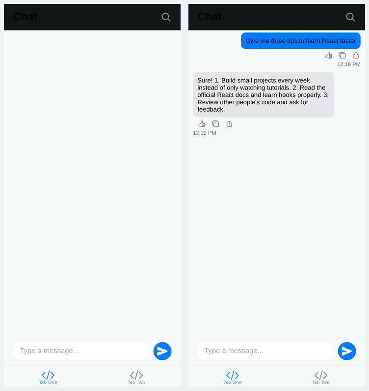
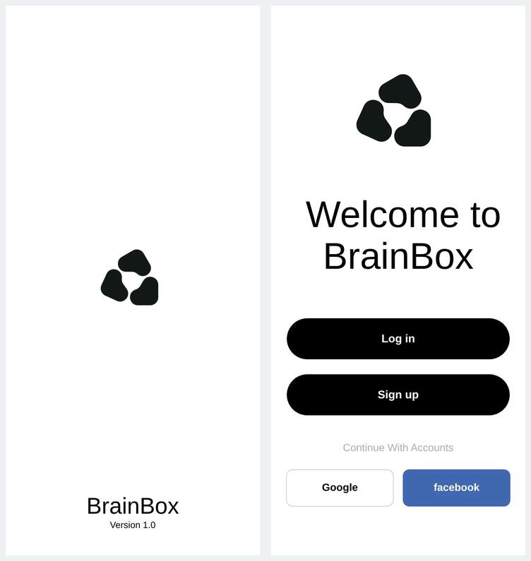
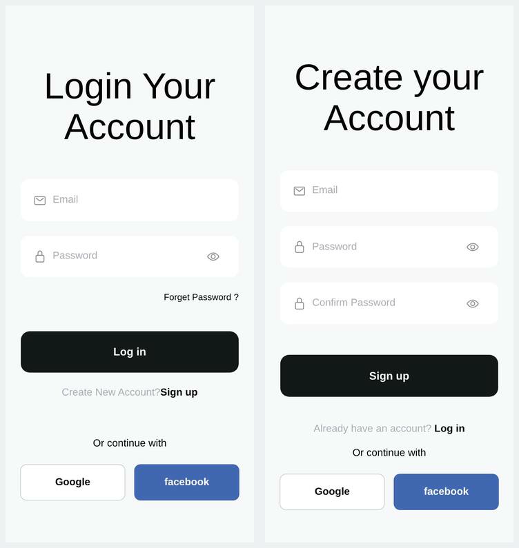
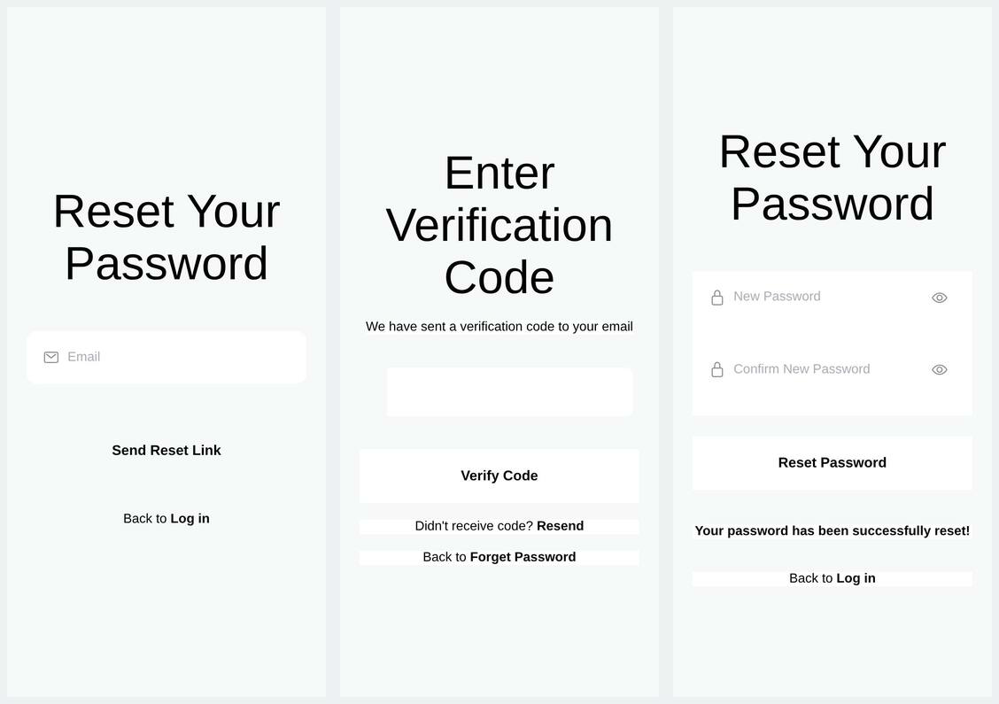

# BrainBox

BrainBox is a cross-platform AI chat app built with React Native and Expo. It talks to Google's Gemini 2.5 Flash model and ships with a full set of authentication screens, an animated splash and a swipeable onboarding flow. It runs on iOS, Android and the web from one codebase and follows the device light or dark theme.

---

## Features

### Chat

- **AI chat with Gemini** - send a message and get a reply from `gemini-2.5-flash` through the Generative Language REST API. A system prompt sets the BrainBox persona: friendly, concise, replies in English or Arabic.
- **Message bubbles and timestamps** - user and AI messages are styled differently, each with a time label and like, copy and share buttons (the buttons are UI only for now).
- **Auto-scroll and loading state** - the list scrolls to the newest message, and the send button turns into a spinner while a request is running.
- **Error handling** - rate limits (HTTP 429) and other failures show up in the chat as a readable message.
- **Cached requests** - responses go through TanStack Query with a 5-minute stale time and one retry.

  

### Onboarding

- **Splash screens** - logo splash that moves to a second splash after 3 seconds.
- **Onboarding slider** - three swipeable slides built with `react-native-reanimated-carousel`, with pagination dots and a Skip button.
- **Welcome screen** - entry point with Log in, Sign up, Google and Facebook buttons.

  

### Authentication screens

- **Login and Register** - email and password fields with show/hide password toggles, links between the two screens and social sign-in buttons.
- **Password recovery** - Forget Password, Enter Verification Code and Reset Password screens, linked in order.

  

  

> The authentication screens are UI only for now. Forms are not submitted to a backend and Firebase is configured but not wired to sign-in yet.

### Theming and platforms

- **Light and dark mode** - colors switch with the system theme through a themed `Text`, `View` and `TextInput`.
- **File-based routing** - Expo Router with a tab layout for the chat and stack screens for onboarding and auth.
- **One codebase** - iOS, Android and web (`react-native-web`), with the New Architecture enabled.

---

## Tech Stack

| Area | Tools |
| --- | --- |
| Framework | React Native 0.81, Expo SDK 54, React 19 |
| Language | TypeScript |
| Navigation | Expo Router 6, React Navigation |
| Data | TanStack Query, Axios |
| AI | Google Gemini 2.5 Flash (REST API) |
| UI and motion | React Native Reanimated, Reanimated Carousel, Expo Vector Icons |
| Backend services | Firebase (configured) |

## Project Structure

```
app/            Screens and routes (chat tab, onboarding, auth flow)
components/     Chat list, message bubble, message input, header, themed views
api/            Gemini request (FetchChat)
hooks/          useFetchChat (TanStack Query wrapper)
providers/      Query client provider
constants/      Colors and Firebase config
data/           Onboarding slides
types/          Gemini response types
```

## Getting Started

```bash
npm install
```

Create a `.env` file with your keys:

```
EXPO_PUBLIC_API_KEY=your_gemini_api_key
EXPO_PUBLIC_FIREBASE_API_KEY=...
EXPO_PUBLIC_FIREBASE_AUTH_DOMAIN=...
EXPO_PUBLIC_FIREBASE_PROJECT_ID=...
EXPO_PUBLIC_FIREBASE_STORAGE_BUCKET=...
EXPO_PUBLIC_FIREBASE_MESSAGING_SENDER_ID=...
EXPO_PUBLIC_FIREBASE_APP_ID=...
EXPO_PUBLIC_FIREBASE_MEASUREMENT_ID=...
```

Then start the app:

```bash
npm run web       # browser
npm run android   # Android
npm run ios       # iOS
```

> `EXPO_PUBLIC_` variables are bundled into the client. For production, move the Gemini call to a small backend so the key stays private.

## Screenshots

Screenshots were captured from the Expo web build at phone size (390 x 844). The AI reply in the chat screenshot is a sample response.

## Author

Amr Maher - Front-End Developer. [GitHub](https://github.com/Amrr-Maherr) | [LinkedIn](https://www.linkedin.com/in/amrr-maherr/)
